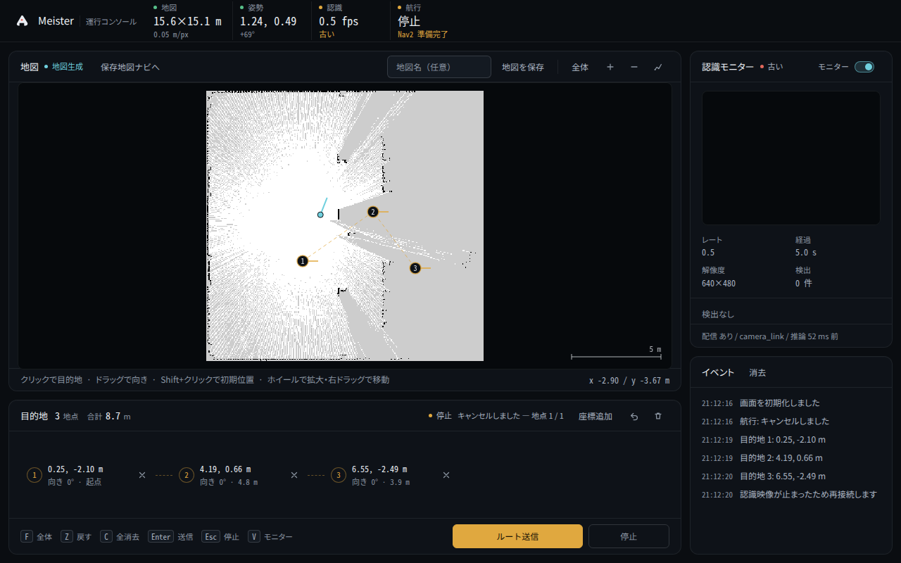
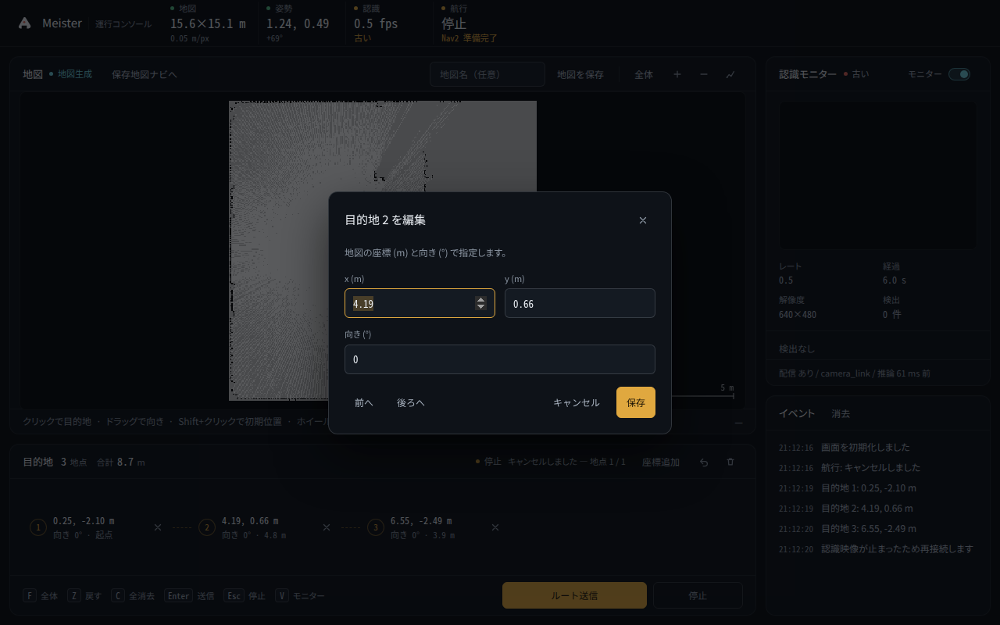

# 設計: Web UI

> 対象: `ros/src/umeonigiri_webnav`（HTTP :8088 + MJPEG）
> 作成日: 2026-08-12 | 更新: 2026-11-22 | ステータス: 実装済み
> 旧 `docs/design/05-web-ui.md`。2026-11-22 にここへ移した。
> 起動と API の使い方は [commands.md](../../commands.md)、実行時の罠は
> [pitfalls.md](../../pitfalls.md) P16〜P18、ファイル単位の地図は [code-map.md](../../code-map.md)。

## 構成

```
ブラウザ (バニラ JS / ES モジュール, ビルド無し)
  ├ /api/map (2 s) /api/map.png (ETag + 304)
  ├ /api/pose (0.1 s) /api/status (0.1 s) /api/vision (0.5 s)  … タブ表示中のみ
  └ /api/vision.mjpg (MJPEG, 1 接続を張りっぱなし)          … タブ表示中のみ
        │
   httplib::Server (127.0.0.1:8088, スレッドプール)
        │  ports.hpp の口だけを見る (ROS 型を出さない)
   ├ MapSource    ← MapListener  (/map TRANSIENT_LOCAL, /tf)   ┐ 同一 executor
   ├ VisionSource ← VisionListener (/detection_image, /detections) ┘ (別スレッド)
   ├ NavSink      ← NavWorker    (/navigate_to_pose action)     … 専用スレッド
   └ ModeSink     ← ModeWorker   (get_mode / map_saver / initialpose) … 専用 executor
```

| 層 | ファイル | 責務 |
|---|---|---|
| HTTP | `http_app.cpp` / `vision_routes.cpp` / `http_support.cpp` | 経路登録、ETag/304、JSON、MJPEG、静的ファイル |
| 変換 | `map_cache.cpp` / `vision_cache.cpp` | メッセージ → ブラウザが貼れる画像と状態 JSON |
| ROS | `map_listener.cpp` / `vision_listener.cpp` / `nav_worker.cpp` / `mode_worker.cpp` | 購読・アクション・サービス・スレッド |
| 口 | `ports.hpp` | `MapSource` / `VisionSource` / `NavSink` / `ModeSink`（gtest はここを stub する） |

`ports.hpp` に ROS 型を出さないので、HTTP 面は ROS グラフ無しでテストできる（AGENTS.md R8）。

## 設計判断

- **地図は内容ハッシュで版管理する**。メッセージ連番だと、同じ地図を再送する publisher が
  連番を進めるだけで ETag が変わり、304 が永久に成立しない。crop（既知セルの bbox + 5% 余白）と
  PNG エンコードは版ごとに 1 回だけ計算する（Python 版は 1 ポーリングで 2 回 crop していた）。
- **地図の再取得では表示位置を変えない**。2 秒ごとに `Image` を作り直すが、全体表示に
  合わせ直すのは地図の同一性（サイズ・解像度・原点）が変わったときだけ。地図更新のたびに
  操作中のパン・ズームが巻き戻るのを防ぐ。ウィンドウのリサイズは、利用者がまだパン・
  ズームしていなければ全体表示に追従し、操作後は表示を保つ。
- **描画は 1 フレーム 1 回**。`pointermove` は 1 フレームに複数回来るので、その都度描くと
  後から来た座標で同じ絵を作り直す。`requestAnimationFrame` でまとめ、ステージの大きさも
  `ResizeObserver` のときだけ測って、描画前の強制レイアウトを避ける。
- **非表示タブでは取得と MJPEG を止める**。戻ったときに取り直す。推論は監視 ON の間
  サーバー側で続く（購読は張ったまま）ので、止めるのは転送と描画だけ。
- **地図 PNG は共有したまま配る**。`MapSource::RenderPng` は `shared_ptr<const string>` を
  返し、キャッシュと同じ実体を指す。地図が変わっていないときは 304 で捨てるだけなので、
  1 MB 級のバイト列をコピーしない。crop は `/map` を受けたスレッドで済ませ、PNG だけを
  要求時に作る（encode 中も `/api/map` は待たない）。
- **PNG は圧縮レベル 0**。配信先は同じホストのブラウザだけで、loopback のバイト数は
  ほぼ無料。既定（レベル 3）の 62 ms が 18 ms になり、地図が動いている間の
  HTTP スレッド占有が減る（1000x1000 の実測）。
- **静的ファイルは (mtime, size) を版にしてメモリに持つ**。1 画面で 13 本の asset を
  取るので、毎回ディスクから読むとページ表示のたびに無駄が積まる。ETag を付けて
  再読み込みは 304 で済ませる。
- **TCP は TCP_NODELAY・keep-alive 多め**。既定のままだと、応答ヘッダと本文を別々に
  送ったときに Nagle と delayed ACK が噛み合い、同じ接続の 2 回目以降が 40 ms
  待たされる（実測 p50 42 ms）。keep-alive の既定 5 要求も、1 秒おきに引く画面では
  すぐ TCP を張り直すことになる。
- **HTTP ハンドラで秒単位に待たない**。1 本詰まるとスレッドプールが枯れ、無関係な
  要求まで止まる（実測: `/api/mode` を 2 秒ごとに引く画面で地図も姿勢も返らなくなった）。
  モード照会は待ち時間ゼロ、切替と保存だけは上限付きで待つ。
- **PNG は `cv::imencode`、認識画像は JPEG（品質 80）**。認識画像は 3 Hz で流れ続けるので、
  可逆圧縮の PNG を毎フレーム送ると帯域もブラウザのデコードも無駄になる。JPEG への変換は
  購読コールバックで 1 回だけ行い、`/api/vision.jpg` と MJPEG は同じバイト列を共有する。
- **検出の対応付け**は `Detection2D.id`（クラス名）・`results[0].hypothesis.score`・
  `bbox.center.position` / `size_x` / `size_y`（画素）。1 応答 12 件・スコア降順に丸める。
- **MJPEG は chunked のまま押し出す**。ブラウザ側は `` を 1 本張るだけでよく、
  JS で毎フレーム描き直すより軽い。ただし**終わらない応答なので `load` イベントが完了しない**
  （タブが「読み込み中」のままになる）。フロントは `load` 後に `src` を張る。
- **監視 ON/OFF は購読の作成/破棄で行う**。`detection_node` は購読者が居ない間だけ推論を
  止める設計（`detection_node.cpp` の `AnyoneListening()`）なので、購読を外すことがそのまま
  CPU を空ける操作になる。作成/破棄は **executor スレッドのタイマー**（200 ms）で行い、
  HTTP スレッドは `enabled_` を立てるだけにする（executor の callback group 収集と競合させない）。
- **既定は ON**。認識モニターは「見たいときだけ見る」機能ではなく、遠隔でロボットの
  見え方を確認する主要な計器なので、起動直後から映る方を既定にする。CPU を空けたいときは
  UI の 1 ボタンで切る。
- **初期位置は地図の Shift+クリック**。保存地図ナビへ切り替えると AMCL は
  初期姿勢を待つ。UI に専用のボタンを増やさず、目的地と同じ「クリック＋ドラッグ」で
  位置と向きを渡せるようにした（押した瞬間の修飾キーを覚えるので、押下中に
  Shift を離しても取り違えない）。
- **`Cache-Control` の使い分け**: 地図 PNG は `no-cache`（保存してよいが必ず再検証 = ETag で
  304）、認識画像は `no-store`（1 枚ごとに別の絵なので保存に意味が無い）。
- **MJPEG は切れたら張り直す**。`` の `error` だけに頼らず、最初のフレームが
  4 秒来なければ URL を変えて再接続する（失敗間隔は最大 30 秒まで倍々）。サーバー再起動後に
  同じ URL を張り直すと、ブラウザが失敗した画像を再利用して固まることがあるため、
  再接続の URL には毎回別のクエリを付ける。途中で固まるケースは `error` に依存する。
- **依存**: cpp-httplib（`libcpp-httplib-dev`、CMake config が無いので pkg-config で引く）と
  nlohmann/json（`nlohmann-json3-dev`）。**nlohmann-json3-dev は rosdep キーを持たない**
  （`rosdep resolve nlohmann-json3-dev` / `nlohmann_json` ともに "no rosdep rule"）ため
  `package.xml` には書かない。書くと `rosdep install` がワークスペースごと落ちる。apt 直入れ前提。

## 画面デザイン



夜間の運用席で1人が長く見る計器として纏めた。画面の性格は「静かで、正確で、現場に馴染む」。

- **2 列**: 左が「命令する側」(地図 + ルート)、右が「観測する側」(認識モニター + イベント)。
  地図は地図の縦横比 (`--map-aspect`) で高さが決まるので、横長の地図でも黒い余白が
  画面の主役にならない。正方形の地図はステージの中で中央に置き、クリックを受け付けるのは
  地図の矩形の内側だけ（外側は「地図外」と表示して目的地にしない）。
- **ルートは地図の下の横帯**。停止点は番号・座標・向き・前の地点からの距離を持ち、
  地図の破線を横方向の破線で繰り返す。地点数と合計は見出し、送信と停止は足元に置く。
- **巡回中の地点が分かる**。航行中は `/api/status` の `current_waypoint` でリストの 1 点を
  反転し、地図側も同じ点に輪を足す。航行中は目的地の追加・削除・全消去とモード切替を
  凍結し、画面のルートと実際に走っているルートを食い違わせない。
- **座標で追加・編集**: ルート見出しの「座標追加」で x/y/向きを直接入力する。各停止点の
  本文はボタンで、押すと同じダイアログで位置・向きを直せる。「前へ/後ろへ」で 1 点ずつ
  順序を入れ替える。航行中は開けない。キーボードだけでも追加まで完結する。
- **操作は対象のパネルへ**: モード表示・切替・地図名・保存は地図の見出し、
  モニターの ON/OFF は認識モニターの見出し、副操作 (戻す・全消去) は目的地の見出し。
  ヘッダには名乗りと 4 つの計器だけを残す。
- **面は無彩色**。背景・パネル・文字は 1 本のグラファイトの階調から取り、色は
  **操作者が引いたルート (amber)** と **生きているロボット (cyan)** にだけ置く。
  グロー・グラデーション・丸薬バッジ・色付きカードは全部外した。
- **ルート線が署名**。地図の点線を、目的地リストの横の破線と丸い番号で繰り返す。
  画面を見れば「人がどこへ行かせようとしているか」が一発で読める。
- **マークは梅おにぎり**。米は文字色・海苔は背景色の抜き・梅は赤のフラットな SVG。
  ヘッダと favicon で同じ形を使う（`webui/favicon.svg`）。絵文字やグラデーションの
  ロゴタイルは使わない。
- **文字は 6 段**（メタ 11 / ラベル 12 / 本文 13 / 強調 14 / 計器の値 16 / 表示 20）。
  日本語は Noto Sans CJK JP、数字とメタは JetBrains Mono。階層は太さではなく
  大きさと色で作り、11px 未満は使わない。数字はすべて等幅数字で桁を揃える。
  メタの色は 4.5:1 を割らない（`--ink-3` #8a94a1）。
- **余白は 4px の目盛り**、角丸は 4 / 6 / 8 / 12。パネルの中の入れ子は
  「外の半径 − 余白」で決める。同じ役割のものは同じ高さ・同じ間隔にする。
- **面は 4 段のグラファイト + hairline**。地図と認識映像だけを一段沈めた
  「ライトテーブル」に置き、色はルート (amber) とテレメトリ (cyan) に残す。
  状態は塗りではなく 5px の点と注記の色で言う（計器・記章・認識モニターの点）。
- **主操作だけを塗る**。`ルート送信` だけがアンバーで、`停止` は赤い文字、
  それ以外は静かな面に置く。無効な主操作はアンバーを残さない。
- **計器と読み取り**: 地図は物理寸法 (m) と解像度、姿勢は x/y と向き、認識は fps と
  受信状態（受信中 / 古い / 映像待ち / 停止中）、航行は状態と Nav2 の準備。検出件数は
  パネルに任せ、同じ数字を 2 か所に出さない。地図の足元にはカーソル座標と、ドラッグ中の
  向き（地図の外なら「地図外」）を出す。
- **キーボード**: `F` 全体 / `Z` 戻す / `C` 全消去（取り消し可） / `Enter` 送信 /
  `Esc` 停止 / `V` モニター。`Esc` は文字入力中でも効く。文字入力中の文字キーは
  ショートカットに使わない。ボタン上の `Enter` はそのボタンの操作として渡し、
  ルート送信を横取りしない。地図にフォーカスがあるときは矢印キーで視点を移動する。
- **送信は Nav2 の準備後**。準備ができるまで送信ボタンは `Nav2 待ち` の表示で無効。
  スマホでは計器の注記を隠すため、理由をボタンのラベル自体で言う。
- **タッチの地図移動**: 1 本指は目的地の追加/向き指定に使うため、地図ヘッダに
  「移動」ボタン（タッチ環境のみ）を置く。オンなら 1 本指ドラッグで視点移動し、
  足元のヒントも「ドラッグで移動」に変わる。マウスは右/Alt ドラッグで移動する。
- **トーストは下を塞がない**。上に置き、クリックを受け取るのは「元に戻す」の口だけ。
  通知が 4 秒表示されても、その下のスイッチやボタンは操作できる。
- **全消去は取り消せる**。実行後 8 秒間トーストに「元に戻す」を出し、その間に
  目的地が増えていなければ元の一覧へ戻す。

座標の追加・編集は、地図の上に重ねたダイアログで行う。



- **1 列 (980px 以下)**: 地図→目的地→認識→イベントの順に積み、ページがスクロールする。
  640px 以下では `ルート送信` / `停止` を画面下に固定し、地図で目的地を足した直後に
  押せるようにする。計器は 1 行 4 列（320px 級は 2 列）にし、注記は省いて高さを抑える。
- **焦点と動き**。`:focus-visible` はアンバーの輪 (形は変えない)、
  `prefers-reduced-motion: reduce` では遷移を止める。ループする装飾的な動きは無し。

## スレッド構成

| スレッド | 動くもの | 注意 |
|---|---|---|
| httplib のプール | 経路ハンドラ。MJPEG のフレーム待ちは条件変数で最大 1 秒 | executor を掴まない。秒単位で待たない |
| ROS executor (SingleThreaded) | `/map`・`/tf`・`/detection_image`・`/detections` のコールバックと監視 ON/OFF タイマー | 画像の JPEG 化はここで 1 回だけ。crop もここで済ませる |
| NavWorker | action client と結果待ち | 専用スレッドなので executor と競合しない。待ちには上限を付ける |
| ModeWorker | `get_mode` / `switch_to_localization` / `map_saver` / `/initialpose` | 専用 executor で常に回す。HTTP 側は「待つだけ」で spin しない |

## 実装上の逸脱（Python 版との差）

| 項目 | Python 版 | C++ 版 | 影響 |
|---|---|---|---|
| 地図 PNG のバイト列 | PIL | `cv::imencode` | 画素は同じ、バイト列は別物。ETag は内容ハッシュなので 304 の成立に影響しない |
| 版ハッシュ | BLAKE2b(8) | FNV-1a 64 | ETag の文字列が変わる（キャッシュは 1 回作り直される） |
| 本文上限超過 | 400 + `{"error": ...}` | httplib が 413 | 1 MB 超の本文のみ。UI は送らない |
| Nav2 起動待ち | `nav2_simple_commander` | `bt_navigator/get_state` のポーリング + action server 待ち | 状態機械の文字列は同じ |

## 未検証（✗）

- ブラウザでの描画結果: ヘッドレス Chrome でモック API と実 `umeonigiri_webnav_server` の空状態を
  確認（2026-11-18）。実機の運用ブラウザでの長時間表示は ✗ 未検証（配線は `id` の
  突き合わせ・`/api/*` の突き合わせ・ES モジュールの構文と解決で機械検証している）
- 認識モニター ON のときの Orange Pi 5 Max での CPU 使用率（開発機では 3 Hz 動作を実測）
- 長時間運用での MJPEG 接続の安定性。サーバー再起動後の再接続は Chrome で確認（上記）。
  途中で固まるケースと連続運用は ✗ 未検証

## セキュリティ

`127.0.0.1` のみに bind する。外部公開する場合は認証・TLS と、静的ファイル配信の
パストラバーサル対策（`weakly_canonical` の前方一致）の再確認が要る。
