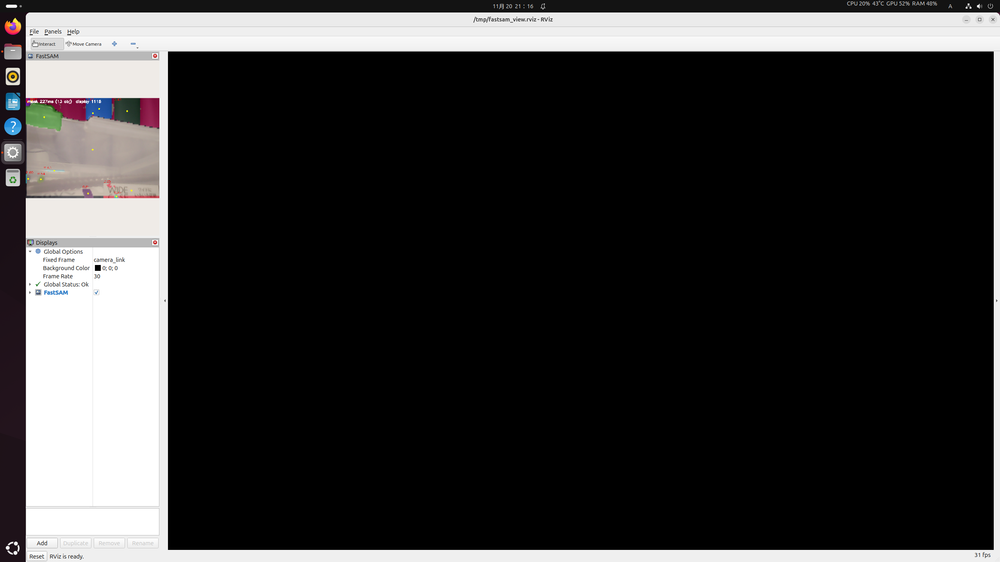

# FastSAM-s を Orange Pi 5 Max (RK3588 NPU) で動かす — 2026-11-20 実測

セグメンテーション（マスク）を NPU で出すための実験記録。**動作確認済み**。

## 結論（実測）

| 項目 | 値 |
|---|---|
| モデル | 参照リポジトリに**同梱**（`FastSAM_S.rknn` 12 MB / `FastSAM-x_640x352.rknn` 71 MB） |
| 入力 | 640x640x3 INT8 (NHWC)、mean 0 / std 255 |
| 出力 | 10 本（3 スケール × reg/cls/mc ＋ `seg` 160x160x32） |
| **推論 (NPU) S** | **59.0 / 59.2 / 60.7 ms**（3 回、640x640） |
| **推論 (NPU) X** | **171.8 ms**（640x352） |
| 後処理 (CPU) | 10.1〜35.2 ms（画像・検出数に依存） |
| 検出数 | 画像次第（4〜28） |

比較: YOLOv8n の NPU 推論は 20.7 ms（`tools/rknn/README.md`）。

## S と X は「速度」ではなく「品質」で選ぶ（実測で判明）

同じ画像（リポジトリ同梱の `test.jpg`）で比べた結果:

- **S (640x640, 57 ms)**: マスクが 16x16 程度のブロック状に崩れ、
  物体の輪郭を捉えていない。把持姿勢の算出には使えない。
- **X (640x352, 172 ms)**: バナー・壁・床・棚がきれいに分離される。
  同梱の `test_result.jpg`（作者の期待結果）と同等の品質。

**S は 3 倍速いが品質が足りない。** 実運用でマスクを使うなら X。
「速いモデルを選ぶ」判断は品質を見てから行うこと。

## 重要な発見: モデル変換は不要だった

参照リポジトリ `cqu20160901/FastSAM_rknn_Cplusplus` の
`examples/rknn_fastSAM/model/RK3588/` に **`FastSAM_S.rknn` と
`FastSAM-x_640x352.rknn` が同梱**されている。手順で想定していた
「ONNX エクスポート → INT8 変換」を飛ばして、そのまま実行できる。

自前のモデル（別入力サイズ・別キャリブ）を作りたい場合のみ変換が必要。
その場合 `rknn-toolkit2` の **aarch64 wheel** でこの機体上で変換できる
（`tools/rknn/README.md`）。

## 手順（実測で通ったもの）

```bash
git clone --depth 1 https://github.com/cqu20160901/FastSAM_rknn_Cplusplus.git /tmp/fastsam_rknn
cd /tmp/fastsam_rknn/examples/rknn_fastSAM

# 1) ビルド。ネイティブ gcc だと CMake が armhf を選び、同梱の armhf OpenCV を
#    引いて opencv2/highgui.hpp 不在で失敗する。aarch64 接頭辞付きを明示する。
mkdir -p build && cd build
cmake .. -DCMAKE_SYSTEM_NAME=Linux -DTARGET_SOC=rk3588 \
  -DCMAKE_C_COMPILER=aarch64-linux-gnu-gcc \
  -DCMAKE_CXX_COMPILER=aarch64-linux-gnu-g++
make -j4

# 2) main.cc の 3 つのパス（model / image / save）を自分の環境に書き換える

# 3) 実行。librga は同梱のものを使う（システムには .so の開発リンクが無い）
LD_LIBRARY_PATH=/usr/lib:/tmp/fastsam_rknn/examples/3rdparty/rga/RK3588/lib/Linux/aarch64:\
/tmp/fastsam_rknn/runtime/RK3588/Linux/librknn_api/aarch64 \
  ./rknn_FastSAM_demo
```

出力（640x640 入力・FastSAM_S）:

```
model input height=640, width=640, channel=3
once run use 59.027000 ms
postprocess run use 28.089000 ms
== obj: 24
```

## 注意・未検証

- **ランタイムの版を合わせること。** 同梱 `.rknn` はリポジトリ同梱の
  `librknnrt` **1.4.0** を前提にしている（システム側は 1.5.2）。
  1.5.2 でも推論は通るが、S では色配置が変わる程度の差が出た。X では差が分からない。
  再現性を取るなら**同梱 runtime を `LD_LIBRARY_PATH` の先頭に置く**。
- 暗い室内画像では X でもマスクが粗くなる。明るさとコントラストに依存する。
- 後処理が重い（最大 35 ms）。検出数に比例するので、把持対象を 1 個に絞る
  前提なら実用域に入る可能性がある。**最適化は未着手**。
- 把持姿勢の算出（背景除外・面積下限・中心に近いマスクの選択・`cv::minAreaRect`）
  は**未実装**。参照リポジトリのデモはマスクの可視化までしか行わない。

## 次の段階（未着手）

1. 明るい実シーンでマスク品質を確認する（ここが通らないと先に進めない）
2. 背景・小面積・画面端を除外し、中心に最も近いマスクを 1 つ選ぶ
3. `cv::minAreaRect` で (x, y, θ) を出し、`grasp_2d` として配信
4. 後処理の高速化（マスク生成を 160x160 のまま扱い、必要な 1 個だけ拡大する）

## 検出した物体の中心座標（実装済み）

`local_patch.patch` を参照リポジトリに当てると、結果ループで
bbox 中心と正規化座標を出力し、画像に中心点（黄）を描く。

```
obj 0: conf=0.83  bbox=(0,0)-(640,480)      center=(320,240)  norm=(0.500, 0.500)
obj 1: conf=0.44  bbox=(0,258)-(640,480)    center=(320,369)  norm=(0.500, 0.769)
obj 2: conf=0.36  bbox=(529,0)-(640,282)    center=(584,141)  norm=(0.913, 0.294)
obj 3: conf=0.30  bbox=(165,271)-(271,480)  center=(218,375)  norm=(0.340, 0.782)
```

座標は `DetectiontRects`（`classId, conf, xmin, ymin, xmax, ymax` を 1/画像サイズで
正規化した 6 要素）の bbox 中心。**マスク重心ではない**ので、三日月形の物体では
bbox 中心が物体の外に出る。把持点にするならマスク重心か `minAreaRect` の中心へ
置き換えること（未実装）。

## 実カメラ（Fushicai USB2.0 / 640x480）で試した結果 — 2026-11-20 21:00

`/dev/video0` から 1 フレーム取得（明るさ平均 151/255）して、同じフレームを
S と X に通した。入力と結果は `live_input.jpg` / `live_fastsam_s.jpg` /
`live_fastsam_x.jpg`。

| モデル | 推論 | 後処理 | 物体数 | マスク |
|---|---|---|---|---|
| FastSAM-S (640x640) | 58.2 ms | 16.0 ms | 9 | ❌ ブロック状で輪郭に沿わない |
| FastSAM-x (640x352) | 172.3 ms | 8.1〜36.2 ms | 11 | ✅ カーテン・壁・棚・棚上の物が分離できる |

**明るい実写でも S の品質は変わらない**（S の問題であって照明の問題ではない）。
把持姿勢に使うなら X 一択。S は 58 ms（約 13 fps）で速いが、輪郭が取れないので
`minAreaRect` に渡しても意味のある角度が出ない。

X の後処理時間は 8〜36 ms とばらついた（同時に走っているプロセスに左右される。
この計測は単発実行なので、確定値としては扱わない）。

X の中心座標の例（`local_patch.patch` の出力）:

```
obj 0: conf=0.84  bbox=(445,101)-(566,152)  center=(505,126)  norm=(0.789, 0.264)
obj 4: conf=0.62  bbox=(434,133)-(640,327)  center=(537,230)  norm=(0.839, 0.479)
obj 6: conf=0.53  bbox=(525,304)-(640,478)  center=(582,391)  norm=(0.910, 0.815)
```

## 引数の渡し方（ローカル改造）

`local_patch.patch` を当てると、モデル・入力画像・出力画像を引数で差し替えられる。

```bash
./rknn_FastSAM_demo <model.rknn> <input.jpg> <output.jpg>
```

## リアルタイム表示（RViz ウィンドウ）

カメラ → NPU 推論 → `/fastsam_image` 配信 → RViz の Image 表示、までを繋いだ。



実測（640x480 カメラ、FastSAM-x）: **配信 22.1 Hz / マスク更新 4.6 Hz**、
推論 182 ms。画面左上に「mask 227ms (13 obj)」を焼き込んでいる。

### ラグの原因と対策（実測）

最初の実装は「取得 → 推論 → 配信」を 1 本のループで回していた。カメラは
**25.3 fps** 出るのに推論は **182 ms（5.5 fps）**なので、V4L2 のキューに
フレームが溜まり続け、**常に数秒前の絵**を表示していた。`cap.read()` が
0〜1 ms で返る（＝キューが空にならない）ことがその証拠。

対策として取得・配信と推論をスレッドで分離し、**推論するのは常に最新フレーム
だけ**にした（古いフレームは捨てる）。結果、配信はカメラレートの 22.1 fps に
なり、遅延は「1 フレーム + 推論時間」に固定される。

| | 配信 | マスク更新 | 体感 |
|---|---|---|---|
| 逐次（修正前） | 4.4 Hz | 4.4 Hz | 数秒遅れてカクつく |
| 分離（修正後） | **22.1 Hz** | 4.6 Hz | 滑らか、枠は 0.2 秒遅れ |

### 30 fps について

- **カメラの上限が 25.3 fps**（640x480 でも 320x240 でも同じ）。このカメラでは
  30 fps は出せない。
- マスク自体を 30 fps にするには推論 33 ms 以下が必要。現状 182 ms（FastSAM-x）、
  最速の FastSAM-s でも 57 ms（17.5 fps）なので**届かない**。
- 到達させるには入力解像度を下げた `.rknn` を作る（画素比で効く。
  320x176 なら約 1/4）。ONNX の再エクスポートと変換が要る（`tools/rknn/README.md`）。

### ビルド

```bash
git clone --depth 1 https://github.com/cqu20160901/FastSAM_rknn_Cplusplus.git /tmp/fastsam_rknn
cmake -S tools/fastsam -B /tmp/fastsam_node/build \
  -DFASTSAM_THIRD_PARTY=/tmp/fastsam_rknn/examples/rknn_fastSAM
cmake --build /tmp/fastsam_node/build -j4
```

`postprocess.cc` は参照実装のものをそのまま使う（Apache-2.0）。
自前実装に置き換えるのは別作業。

### 実行

```bash
# 1) 配信ノード（モデル / カメラ / トピック名）
/tmp/fastsam_node/build/fastsam_stream \
  /tmp/fastsam_rknn/examples/rknn_fastSAM/model/RK3588/FastSAM-x_640x352.rknn \
  /dev/video0 /fastsam_image &

# 2) RViz（Image 表示のみの設定）
rviz2 -d tools/fastsam/fastsam_view.rviz
```

`--fullscreen` は付けても動くが、**Wayland では画面キャプチャが黒くなる**
（直接スキャンアウトのため）。確認用途ならウィンドウ表示のまま撮ること。

### 注意

- この機体では 4.4 Hz。**推論 182 ms が支配的**で、
  カメラ（12 Hz 前後）より遅い。滑らかに見たいなら点数を落とすか、
  入力解像度を下げた `.rknn` を作る必要がある（`tools/rknn/README.md`）。
- 毎フレーム `cvtColor` + `resize` をかけている（RGA は使っていない）。
  ここは 2〜3 ms 程度で、ボトルネックではない。
- `postprocess.cc` が標準出力へ `=== FastSAM MeshGrid Generate success!` を
  毎フレーム出す。ログが埋まるので、常用するなら抑制する。
