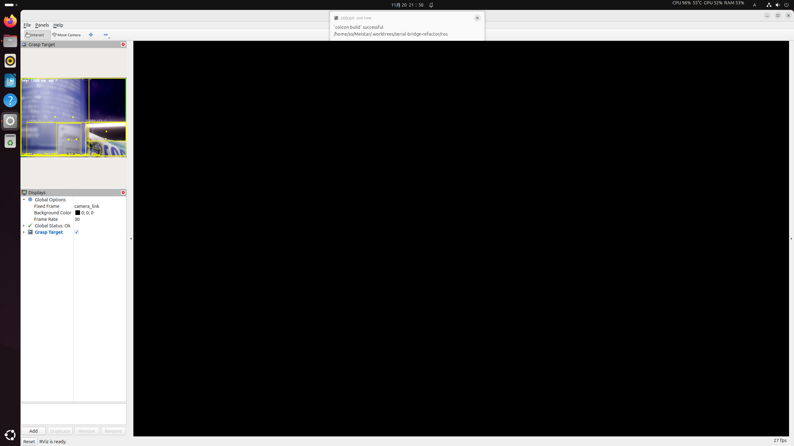

# 把持候補の可視化（yolov8n / NPU）

カメラ → NPU 推論（yolov8n, 80 クラス）→ 物体名と枠 →
枠の内側を OpenCV で輪郭解析して中心・角度・幅 → `/grasp_image` を RViz で表示。



## 使い方

```bash
# モデルは tools/rknn の手順で用意する（tools/rknn/models/yolov8n-zoo.rknn）
python3 tools/grasp/yolo_grasp_stream.py \
  --model tools/rknn/models/yolov8n-zoo.rknn \
  --labels tools/grasp/coco_labels.txt

rviz2 -d tools/grasp/grasp_view.rviz
```

- 一番大きい枠（＝手前にあるとみなす）を **把持ターゲット**として緑枠で強調し、
  画面下に `TARGET <名前> (x,y) angle <度> width <px>` を出す。
- 他の検出は灰枠。マスクは出さない（セグメンテーションはしない）。
- 角度は `cv2.minAreaRect` の長辺方向。`width` は長辺の画素長で、
  指の開き幅の目安。**実寸への換算は未実装**（カメラ距離が必要）。

## 実測（2026-11-20 / Orange Pi 5 Max）

| 項目 | 値 |
|---|---|
| 表示レート | 23 fps（カメラ律速、単独実行時） |
| 推論（NPU のみ） | 20.7 ms（`tools/rknn` のベンチ、48 fps） |
| 推論（このノードの実測） | 114 ms（アイドル時）／176 ms（RViz 同居時） |

### CPU 使用率（2026-11-20 実測）

| 条件 | CPU（1 コア換算） | 推論 |
|---|---|---|
| 初期実装（conf 0.25） | **138%** | 158 ms |
| スコア先行足切り＋配信 15 fps 上限 | **133%** | 157 ms |

**後処理を速くしても CPU はほとんど変わらなかった。** 内訳を測ると NPU 自体は
20.7 ms なのに 1 フレーム 157 ms かかっており、差分の大半は `rknnlite.inference()`
が **9 本の出力（合計 54 万要素）を毎回 float へ展開する処理**と、Python 側の
GIL 競合（配信スレッドが 921 KB のコピーを回す間、推論スレッドが止まる）。

→ **40% を狙うなら C++ へ移すのが本筋**（`tools/fastsam/fastsam_stream.cc` と同じ構成で、
出力を int8 のまま受け取りデコードする）。未着手。

### 目標に対する現状

- 速度: 表示 23 fps（カメラ律速）／推論 157 ms → **未達**（目標 33 ms）
- CPU: **133%** → **未達**（目標 40%）
- どちらも Python 実装が律速。NPU 性能（20.7 ms）には余力がある。

## 未検証・注意

- 暗い室内では検出が誤検出だらけになる（実測: 暗所で 7 件、内容は概ねノイズ）。
  明るくコントラストのある場面で、対象物に枠が正しく付くかは ★要確認★。
- 角度・幅は **画素単位**。把持に使うにはカメラ〜物体距離との対応（キャリブ）が要る。
- 601 クラス（oiv7）へ差し替える場合は、このノードの `--labels` を差し替え、
  出力チャネル数（`[1,605,8400]`）に合わせたポストプロセスが要る
  （`tools/rknn/README.md` の変換手順も未解決）。
- モデルは `.rknn` のため git 管理外。無い場合は先に `tools/rknn` の手順で生成する。
